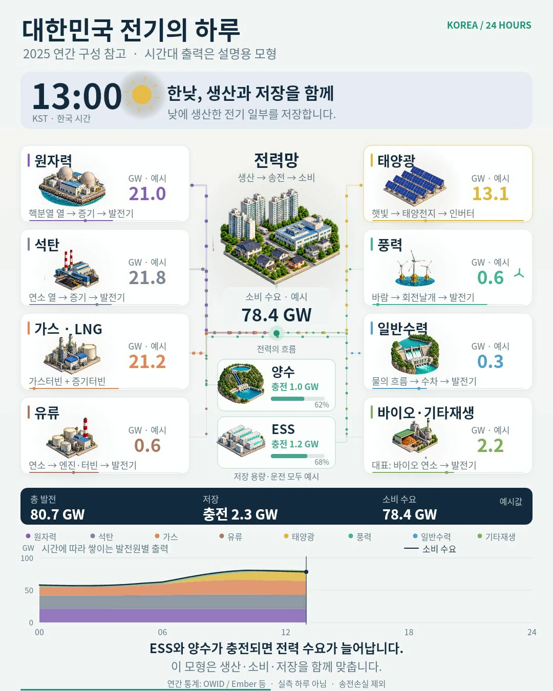

# 대한민국 전기의 하루

[**영상 열기·다운로드 — 90초 / 8.4MB**](https://github.com/doroper98/sci_short/raw/refs/heads/preview/korea-power-day/previews/korea-power-day/korea-power-day.mp4)

원자력·석탄·가스·유류·태양광·풍력·수력·바이오/기타재생, 양수·ESS와 소비를 0시부터 24시까지 연결했습니다. 한국어 설명 자막과 직접 만든 잔잔한 음악이 포함되어 있습니다. 내레이션은 없습니다.

**2025년 한국 연간 공개 통계에 발전 비중을 맞춘 설명용 하루입니다. 특정 날짜의 실측 KPX 운전 영상이 아닙니다.** 시간대별 출력·소비·저장 용량은 가상 시나리오이고 화면에도 이를 표시했습니다.

[출처·모형 가정·재생성 방법](../../samples/korea-power-day/README.md) · [인코딩·수치 검증 기록](validation.json) · [한국어 자막](captions.ko.srt)

1080×1350 / 30fps / H.264·AAC. 전편 디코딩 오류 없음. 실제 휴대전화 재생이나 직접 청취를 확인했다는 뜻은 아닙니다.
